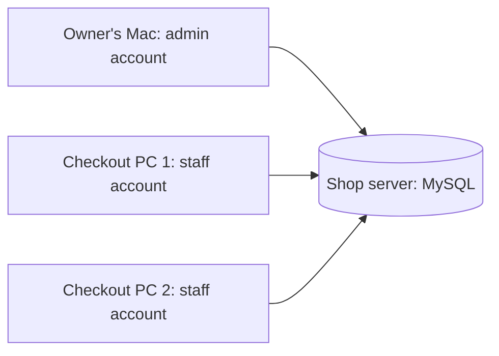

# One shop, several computers

The intended setup is one shared MySQL database on an always-on shop server, with the desktop app installed on each staff PC and the owner's Mac. “Same family” is treated here as the same shop and private LAN/Wi-Fi. Being on the same Wi-Fi does not automatically share the default H2 database.



The admin computer is a client too. It need not stay on, provided the database server stays on. If the server is the admin's computer, that computer must remain awake and connected while staff work. All computers use the same database URL and database credentials, but each person signs in with a separate application account. The owner sees committed sales, product changes, logins, password/account changes and voids through Staff activity. This is an application activity log, not monitoring of the employee's other computer applications.

## Set up a shared test shop

1. Install MySQL 8 on a server with a stable LAN address/DNS name. This workstation has not been provisioned as a MySQL server by this change. The current local `.env` still uses H2.
2. Create an empty database and a dedicated database account. Run the following with a MySQL administrator, replacing the example LAN prefix and password:

```sql
CREATE DATABASE inventory_shop CHARACTER SET utf8mb4 COLLATE utf8mb4_unicode_ci;
CREATE USER 'inventory_app'@'192.168.1.%' IDENTIFIED BY 'REPLACE_WITH_A_STRONG_DATABASE_PASSWORD' REQUIRE SSL;
GRANT SELECT, INSERT, UPDATE, DELETE, CREATE, ALTER, REFERENCES, INDEX
ON inventory_shop.* TO 'inventory_app'@'192.168.1.%';
```

The app currently creates and upgrades its tables at startup, hence the CREATE/ALTER permissions. Start the upgraded version on one machine first so the initial migration finishes before starting other clients. Thereafter schema changes are restartable. Do not mix 1.0 and 1.1 clients: old clients bypass the new price/unit/password rules.

3. Configure MySQL to accept connections on its LAN interface. Permit port 3306 only from the shop computers/subnet. Configure a server TLS certificate whose name matches `shop-server.local` (or your chosen DNS name) and whose issuing CA is trusted by the bundled Java runtime. The template uses `sslMode=VERIFY_IDENTITY`; a self-signed/untrusted certificate will fail until its CA is trusted. See [MySQL's certificate verification instructions](https://dev.mysql.com/doc/connector-j/en/connector-j-server-authentication.html). Do not expose MySQL to the public internet.
4. On **each** computer, create `~/.inventorysystem/.env` (Windows: `%USERPROFILE%\.inventorysystem\.env`) using [the shared-shop template](../InventorySystemi/.env.shop.example). Replace the server hostname and database password. Keep the same currency on all machines. The app reads this file automatically at launch; restart after changes. Environment variables override the file, so remove stale `DB_URL`/`DB_USER` values from the shell when changing profiles.
5. Install the matching native app on each computer. macOS apps are built on a Mac of the matching architecture; Windows apps are built on Windows. They use the same source, not the same installer binary.
6. Start the admin app first, create the first administrator if the database is empty, and add staff accounts in **Staff accounts**. Give each person a unique username and temporary password privately. At first login, staff must replace it before seeing products or creating sales. Canceling the password dialog leaves them signed out.
7. Sign in from the staff computers. The admin's dashboard reloads every 10 seconds, or immediately with Refresh. Staff can see products and their own latest 1,000 sale lines. Admins see all staff sales, reports, account management and the latest 500 audit events.

Existing local H2 stock/accounts are **not automatically copied to MySQL**. For the final-project demonstration, create a fresh shared test shop and seed products through the admin UI. A real data migration needs an explicit export/import and reconciliation procedure; do not just change DB_URL and expect local data to appear.

## Check the complete two-computer workflow

1. Admin creates `cashier1` with a temporary password. Staff logs in on PC 1, changes it, signs out, and confirms the temporary password no longer works.
2. Admin adds `Milk carton`, Piece, quantity `20`, unit price `30.00`, threshold `5`; and `Apples`, kg, quantity `10.000`, unit price `49.99`, threshold `2.000`.
3. Staff sells `2` cartons and `1.250` kg of apples. Stock becomes `18` pieces and `8.750` kg. Expected revenue is `60.00 + 62.49 = 122.49`. The receipt and report use the same rounded line totals. Reports show piece and kg quantities separately.
4. On the admin computer, press Refresh (or wait 10 seconds). Confirm the staff username, sale IDs, quantity/unit and workstation in Staff activity and Sales.
5. Two staff PCs attempt to buy all remaining apples simultaneously. Only the checkout with sufficient stock may commit. A failed cart must save no partial sale, no stock change and no sale audit entry.
6. Admin changes the apple price. Existing reports retain the original sale price. A staff checkout using an old cart price is rejected and must be rebuilt after refreshing.
7. Admin voids a sale. Its row remains marked Voided, stock is restored once, reports exclude it and the action remains in the audit log. A second void cannot restore stock again. Staff cannot void sales.
8. Admin disables the staff account while its app is open. The next application read/write is rejected. Resetting a staff password also invalidates an already-open staff session; staff sign out, log back in with the new temporary password and change it again.
9. Restart both apps and verify persistence. Disconnect a client from the LAN: expect an error, not a successful/offline sale. Reconnect and refresh before selling. Receipts are local to the selling PC, while sales/audit records are shared.

## Trust boundary and next deployment step

This is a desktop client connected directly to a database. Application services enforce roles and password-change requirements, but a person with the database connection password or a modified client can bypass those Java checks. The activity table is not tamper-proof against database administrators. Treat this deployment as a trusted-LAN final-project/pilot setup, not a finished security boundary for untrusted staff computers.

For a production rollout, put an authenticated HTTPS application server between clients and MySQL. The server should hold the database credentials, verify every role, perform stock transactions and write the audit log. Clients should receive short-lived user sessions rather than database passwords. Add login throttling, backups with restore drills, receipt reprinting, shift close/cash reconciliation, payment methods, and product barcode/scale integration. Do not enable offline selling until conflict/reconciliation rules exist.

For a real shop, also add a checkout/order ID grouping the sale lines, payment status, returns with reasons and supervisor approval, and configurable tax rules reviewed for the shop's jurisdiction. Receipts here are non-fiscal records; this release calculates no extra tax.
